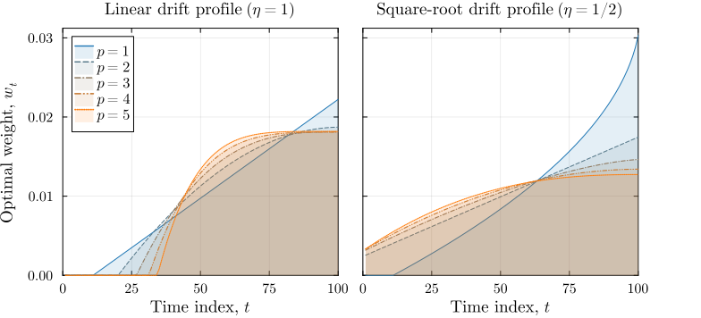

# Don't Look Back in Anger
Repository accompanying the&nbsp;paper:

***Don't Look Back in Anger: Wasserstein Distributionally Robust Optimization with Nonstationary&nbsp;Data***

## Paper Abstract
We study data-driven decision problems where historical observations are generated by a time-evolving distribution whose change over time is bounded in Wasserstein distance. We address this nonstationarity using a distributionally robust optimization model with an ambiguity set that is a Wasserstein ball centered at a *weighted* empirical distribution, thereby allowing for the time decay of past data in a way which accounts for the drift of the data-generating distribution. Our main technical contribution is a concentration bound for weighted empirical distributions that explicitly captures both the effective sample size (i.e., the equivalent number of equally weighted observations) and the distributional drift. Using our concentration bound, we select observation weights that optimally balance the effective sample size against the distributional drift of the data-generating process, taking into account the order of the Wasserstein ball. We also consider simple weighting schemes, and find that across a wide range of problem settings, a triangular weighting scheme is an effective choice that outperforms the classical weighting schemes of time windowing and simple exponential smoothing. Numerical experiments demonstrate the effectiveness of our&nbsp;approach.

## Description
This repository provides implementations of our numerical tests on a distributionally robust newsvendor problem with one or more items, an interior-point solver for observation weights that optimally balance the effective sample size against the distributional drift, a comparison of simple weighting schemes against these optimal weights, and a visualisation of the ambiguity sets of the weighted and intersection&nbsp;approaches.

The following image (Figure&nbsp;2 of the paper) shows the optimal observation weights for different Wasserstein orders and drift&nbsp;profiles.

For full details, see Section&nbsp;4 of the&nbsp;paper.

## Dependencies
You must install a recent version of Julia from http://julialang.org/downloads/. The paper uses Julia&nbsp;1.12 (and Julia&nbsp;1.11 on our high-performance computing&nbsp;cluster).

A number of Julia packages are required. They can be added by&nbsp;commanding:

`using Pkg;  Pkg.add.(["Distributions"; "StatsBase"; "JuMP"; "Ipopt"; "ProgressBars"; "Plots"; "Measures"; "CSV"])`.

## Reproducing Output from the Paper
You can reproduce the following figures by commanding the&nbsp;following:
- Figure&nbsp;1: `include("plot-ambiguity-sets.jl")`
- Figure&nbsp;2: `include("plot-weights.jl")`
- Figure&nbsp;3: `include("plot-worst-case-weighting-efficiencies.jl")`
- Figure&nbsp;4: `include("plot-train-and-test-single-item-drifting-newsvendor.jl")`
- Figure&nbsp;5: `include("plot-train-and-test-multi-item-triptych-drifting-newsvendor.jl")`

Figure&nbsp;3 is drawn from the worst-case efficiencies in "worst-case-weighting-efficiency-data.tsv". If this file is missing, the script first computes them and saves them to it, which takes about half an hour on eight&nbsp;threads.

Figure&nbsp;4 is drawn from the expected costs in "single-item-drifting-newsvendor-costs.tsv", which the script "generate-train-and-test-single-item-drifting-newsvendor-data.jl" generates in about an&nbsp;hour.

Figure&nbsp;5 is drawn from "multi-item-triptych-plot-data.tsv". The script "process-train-and-test-multi-item-triptych-drifting-newsvendor-data.jl" reduces the data files generated by the script "generate-train-and-test-multi-item-triptych-drifting-newsvendor-data.jl" to this table, and to the selected runs in "multi-item-triptych-selected-runs.tsv". The generating script is designed to run in a high-performance computing environment using the "generate-train-and-test-multi-item-triptych-drifting-newsvendor-data.pbs" job submission script and 300 jobs, each of ten repetitions. The data files are too large to host on&nbsp;GitHub.

All of the plotting scripts use "plot-sizing.jl", which centres the plot boxes of each figure and sizes the figure in the points used to include it in the LaTeX&nbsp;source.

The script `weights.jl` provides an implementation of an interior-point solver for computing observation weights that optimally balance the effective sample size against the distributional drift. For a Wasserstein distance&ndash;order `p`, a number of historical observations `T`, a ratio of the drift bound to ambiguity ball size `ρ╱ε`, and a drift-profile exponent `η` (with `η = 1` for a linear drift profile and `η = 1/2` for a square-root drift profile), commanding `Wp_power_law_drift_profile_weights(p, T, ρ╱ε, η)` returns the optimal weights using the Ipopt&nbsp;solver.

## Thank You :pray:
